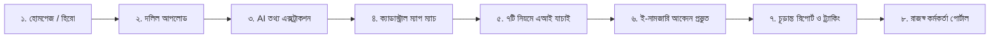

# 🌾 BhuProhori AI (ভূপ্রহরী AI)
> **দলিল দিন, জমি যাচাই করুন, সহজ নামজারি নিশ্চিত করুন।**  
> *Upload Your Deed. Verify Ownership with Live AI. Simplify e-Mutation.*

[](http://localhost:5173)
[](LICENSE)
[](https://ai.google.dev/)
[](https://www.typescriptlang.org/)

**BhuProhori AI** is a modern, citizen-centric, and revenue-officer-assistive platform bridging legal land deeds (দলিল) with digital cadastral land records (খতিয়ান ও মৌজা নকশা). Powered by **Google Gemini 1.5 Flash Multimodal AI**, it detects title fraud, mortgage liens, and double selling, while automating the end-to-end e-Mutation application workflow.

---

## 📑 Table of Contents
- [✨ Key Features](#-key-features)
- [🛠️ Tech Stack](#️-tech-stack)
- [📖 How to Use the Application](#-how-to-use-the-application)
- [⚡ Gemini AI Integration](#-gemini-ai-integration)
- [🚀 Quick Start (Local Setup)](#-quick-start-local-setup)
- [📂 Project Directory Structure](#-project-directory-structure)
- [👥 Developer Team](#-developer-team)
- [⚖️ Disclaimer](#️-disclaimer)

---

## ✨ Key Features

1. **⚡ Live Gemini 1.5 Flash AI Multimodal Document Reader (`/upload`, `/review`)**
   - High-accuracy OCR extraction of 7 core fields: Deed Number, Registration Date, Sub-Registry Office, Grantor/Grantee names, Khatians (CS/SA/RS/BS), Dag (Plot) Number, and Land Area.
   - Real-time AI fraud detection flagging altered figures, missing stamps, and forged seller claims.

2. **🗺️ Interactive Cadastral GIS & Land Map (`/identify`, `/map`)**
   - Interactive Leaflet-based Mouza map with interactive Dag (plot) polygons and ownership breakdown.
   - Synchronized with live Bangladesh Government Mouza Map records (`map.land.gov.bd`).
   - Visual plot safety badges (*Clean Title*, *Bank Mortgage Warning*, *Court Injunction*, *Khas Land*).

3. **🛡️ 7-Rule Cadastral & Legal Verification Engine (`/verify`)**
   - **Dual Verification Mode:** Toggle seamlessly between **⚡ Live Gemini AI** and **📋 Synthetic Rules Simulation**.
   - Evaluates:
     1. Deed Archival Match (সাব-রেজিস্ট্রি রেকর্ড মিল)
     2. Seller Title & Khatian Lineage (মালিকানা স্বত্ব ও নামজারি ধারাবাহিকতা)
     3. Fractional Share & Area Overlap (খতিয়ান হিস্যা ও অতিরিক্ত জমি দাবি)
     4. Mouza & Dag Boundary Coherence (দাগ ও মৌজার নকশা সামঞ্জস্য)
     5. Commercial Bank Mortgage & Lien Check (ব্যাংক দায় ও লিয়েন যাচাই)
     6. Civil Court Litigation & Stay Orders (আদালতের মামলা ও স্থগিতাদেশ)
     7. Khas / Vested Government Land Protection (সরকারি ১নং খাস খতিয়ান সুরক্ষা)

4. **📝 1-Click e-Mutation Application Generator (`/apply`)**
   - Eliminates manual typing by auto-populating validated deed and mapped plot specifics into government-compliant format.

5. **📄 Real-Time Status & Certified Audit Report (`/track`)**
   - Milestone progression timeline (দলিল দাখিল ➔ স্বয়ংক্রিয় যাচাই ➔ কর্মকর্তা পর্যালোচনা ➔ নিষ্পত্তি).
   - Printable certificate report with real-time **Gemini 1.5 Flash AI Verification Seal**.

6. **🏛️ AC Land & Revenue Officer Smart Case Auditor (`/officer`)**
   - AI assistant for land officers (AC Land, Kanungo, Surveyor).
   - Generates risk ratings, detailed legal findings, and ready-to-use draft hearing order sheets.
   - 1-click decision adoption into the official order system.

7. **🌐 Full Bilingual Support**
   - Instant 1-click Bangla (`বাং`) and English (`EN`) localization across all screens.

---

## 🛠️ Tech Stack

| Domain | Technology | Description |
| :--- | :--- | :--- |
| **Frontend Framework** | **React 19** + **TypeScript** | Ultra-fast UI with strict type safety |
| **Build Tool & Server** | **Vite 8** | High-speed HMR development server & production bundler |
| **AI & LLM Engine** | **Google Gemini 1.5 Flash** | Multimodal deed vision, legal reasoning, and discrepancy analysis |
| **State Management** | **Zustand** (with `persist`) | Lightweight reactive state synced with localStorage |
| **Spatial / GIS Mapping**| **Leaflet** & **React-Leaflet** | Interactive vector parcel polygons and cadastral tile layers |
| **Styling & Design** | **Modern Vanilla CSS System** | Clean dark/light accents, glassmorphism, responsive breakpoints |
| **Typography** | **Google Fonts** | `Noto Sans Bengali`, `Hind Siliguri`, and `Inter` |
| **Icons** | **Lucide React** + Custom SVGs | Cohesive modern iconography |
| **Routing** | **React Router v7** | Client-side declarative SPA routing |

---

## 📖 How to Use the Application

Follow these simple steps to test the end-to-end workflow:



### ধাপ ১: দলিল আপলোড করুন (`/upload`)
- কম্পিউটারের ফাইল থেকে একটি দলিলের ছবি বা স্ক্যানকৃত PDF ড্রপ করুন।
- অথবা বিকল্প হিসেবে **"নমুনা দলিল ব্যবহার করুন"** বাটনে ক্লিক করে প্রস্তুতকৃত কাল্পনিক পরিস্থিতি লোড করুন।

### ধাপ ২: AI তথ্য যাচাই ও ফ্রড স্কোর (`/review`)
- বামপাশে মূল দলিল এবং ডানপাশে এআই কর্তৃক পঠিত ফিল্ডগুলো পাশাপাশি মিলিয়ে দেখুন।
- **⚡ Gemini 1.5 Flash AI** বাটনে ক্লিক করে লাইভ OCR বিশ্লেষণ, ফ্রড রিস্ক স্কোর এবং ব্যাংকিং বন্ধক সতর্কতা তাৎক্ষণিক দেখুন।
- কোনো তথ্য সম্পাদনা করতে চাইলে ফিল্ডে সরাসরি টাইপ করুন।

### ধাপ ৩: জমির নকশা ও পার্সেল শনাক্তকরণ (`/identify`)
- ডিজিটাল মৌজা নকশায় আপনার দাগের অবস্থান (যেমন: সাভার মৌজার দাগ ১২৫) স্বয়ংক্রিয়ভাবে শনাক্ত হবে।
- প্লটে ক্লিক করে মোট জমি, খতিয়ান এবং অন্যান্য অংশীদারদের হিস্যা দেখুন।

### ধাপ ৪: ৭টি নিয়মে এআই যাচাই (`/verify`)
- **⚡ Gemini 1.5 Flash লাইভ AI** মোড চালু করে এক ক্লিকে সম্পূর্ণ ভেরিফিকেশন চালান।
- বিক্রেতার প্রাপ্য হিস্যার তুলনায় অতিরিক্ত দাবি (`claimedShare` vs `availableShare`), দ্বৈত বিক্রয় বা ব্যাংকে জমি বন্ধক আছে কিনা তা ডায়নামিক বার ও অ্যালার্ট পিলসের মাধ্যমে যাচাই করুন।

### ধাপ ৫: ই-নামজারি আবেদন জমা (`/apply`)
- পূর্ববর্তী ধাপগুলো থেকে যাচাইকৃত তথ্য স্বয়ংক্রিয়ভাবে ফরমে চলে আসবে। আবেদনকারীর মোবাইল নম্বর ও বিবরণ নিশ্চিত করে **"আবেদন জমা দিন"** বাটনে ক্লিক করুন।

### ধাপ ৬: চূড়ান্ত রিপোর্ট ও ডিজিটাল অডিট সনদ (`/track`)
- আবেদনের ট্র্যাকিং আইডি সহ সম্পূর্ণ অডিট সারসংক্ষেপ দেখুন।
- **Gemini 1.5 Flash ডিজিটাল ভেরিফিকেশন সিল** সহ রিপোর্টটি সরাসরি প্রিন্ট বা PDF হিসেবে সংরক্ষণ করুন।

### ধাপ ৭: সহকারী কমিশনার (ভূমি) পোর্টাল (`/officer`)
- শীর্ষ মেনু থেকে **"অফিসার মোড"** বা `/officer` রুটে প্রবেশ করুন।
- যে কোনো পেন্ডিং আবেদন নির্বাচন করে **"⚡ এআই দিয়ে এই আবেদনটি যাচাই করুন"** বাটনে ক্লিক করুন।
- জেমিনি এআই প্রস্তাবিত খসড়া আদেশনামা ও সুপারিশ এক ক্লিকে গ্রহণ করে আবেদন অনুমোদন বা শুনানির আদেশ দিন।

---

## ⚡ Gemini AI Integration

The platform connects to Google's **Gemini 1.5 Flash API** (`gemini-flash-latest` / `gemini-1.5-flash`) via `src/services/geminiService.ts`:

- **Multimodal Document OCR:** Converts deed scans (Base64 JPEG/PNG) directly into JSON schema data.
- **Cadastral Share Validation:** Evaluates fractional share arithmetic against recorded ceilings.
- **Legal Risk Auditor:** Cross-references commercial bank liens, double registries, and court stay orders.
- **Draft Order Sheet Generator:** Generates Bengali judicial notes for land magistrates.

### API Key Setup
Create a `.env.local` file in the project root:
```env
VITE_GEMINI_API_KEY=YOUR_GEMINI_API_KEY_HERE
```
*(Note: If no `.env.local` is present, the key can also be entered directly through the in-app settings modal stored securely in your browser's localStorage).*

---

## 🚀 Quick Start (Local Setup)

### পূর্বশর্ত (Prerequisites)
- [Node.js](https://nodejs.org/) (Version 18 or 20+ recommended)
- `npm`, `yarn`, বা `pnpm`

### ইনস্টলেশন ও রান

```bash
# ১. রিপোজিটরি ক্লোন করুন
git clone https://github.com/munyimJR/BhuProhori_AI.git

# ২. প্রজেক্ট ফোল্ডারে প্রবেশ করুন
cd "BhuProhori AI"

# ৩. ডিপেন্ডেন্সি ইনস্টল করুন
npm install

# ৪. ডেভেলপমেন্ট সার্ভার চালু করুন
npm run dev
```

ব্রাউজারে `http://localhost:5173` ওপেন করে অ্যাপ্লিকেশনটি ব্যবহার করুন।

### প্রোডাকশন বিল্ড

```bash
# প্রোডাকশন বান্ডল তৈরি করুন
npm run build

# বিল্ড প্রিভিউ রান করুন
npm run preview
```

---

## 📂 Project Directory Structure

```
BhuProhori_AI/
├── public/                     # পাবলিক অ্যাসেটস, আইকন ও ডেভেলপার ছবি
│   └── assets/
├── src/
│   ├── assets/                 # লোগো, ব্যানারের আসল ছবি ও ডেভেলপার পোর্ট্রেট
│   │   ├── Deed Upload.avif
│   │   ├── Status & Audit Report.png
│   │   ├── e-Mutation Application.jpeg
│   │   └── developers/
│   ├── components/             # রিইউজেবল ইউআই উপাদানসমূহ
│   │   ├── Sidebar.tsx         # এক্সিকিউটিভ নেভিগেশন সাইডবার
│   │   ├── Topbar.tsx          # শীর্ষ হেডার ও দ্বিভাষিক সুইচ
│   │   ├── Footer.tsx          # ২-লাইন এক্সিকিউটিভ ফুটার ও ডেভেলপার মোডাল
│   │   ├── UserRoleCapsule.tsx # ইউজার রোল ও সাইন-ইন ক্যাপসুল
│   │   └── LanguageToggle.tsx  # বাংলা / ইংরেজি ভাষা পরিবর্তন
│   ├── data/                   # ডেমো খতিয়ান, দাগ, দলিল ও ৮টি টেস্ট কেস
│   │   └── demoData.ts
│   ├── pages/                  # মূল অ্যাপ্লিকেশন পেজসমূহ
│   │   ├── HomePage.tsx        # ল্যান্ডিং পেজ, ৩-ধাপের নির্দেশিকা ও টাস্ক স্লাইড
│   │   ├── UploadPage.tsx      # দলিল আপলোড ও ড্রপজোন
│   │   ├── ReviewPage.tsx      # পাশাপাশি দলিল ভিউ ও এআই এক্সট্রাকশন
│   │   ├── IdentifyPage.tsx    # ডিজিটাল মৌজা নকশা ও পার্সেল সিঙ্ক
│   │   ├── VerificationPage.tsx# ৭টি নিয়মে লাইভ এআই ভেরিফিকেশন ইঞ্জিন
│   │   ├── ApplicationPage.tsx # স্বয়ংক্রিয় ই-নামজারি আবেদন ফরম
│   │   ├── TrackPage.tsx       # আবেদন ট্র্যাকিং ও এআই সিলযুক্ত রিপোর্ট
│   │   ├── OfficerPage.tsx     # রাজস্ব কর্মকর্তা ড্যাশবোর্ড ও এআই কেস অডিটর
│   │   └── SignInPage.tsx      # নাগরিক ও রাজস্ব কর্মকর্তা লগইন
│   ├── services/
│   │   ├── geminiService.ts    # Google Gemini 1.5 Flash লাইভ এআই সার্ভিস
│   │   └── verificationEngine.ts # রুল-বেসড যাচাইকরণ লজিক
│   ├── store/
│   │   └── useAppStore.ts      # Zustand গ্লোবাল স্টেট ম্যানেজমেন্ট
│   ├── types/
│   │   └── index.ts            # ডোমেন মডেল ও টাইপস্ক্রিপ্ট ইন্টারফেস
│   ├── utils/
│   │   └── translations.ts     # সম্পূর্ণ বাংলা ও ইংরেজি শব্দভাণ্ডার
│   ├── App.tsx                 # রুট কনফিগারেশন
│   ├── main.tsx                # অ্যাপ বুটস্ট্র্যাপ
│   └── index.css               # গ্লোবাল আধুনিক সিএসএস ও টাইপোগ্রাফি
├── .env.local                  # গোপন এআই কি (গিট ইগনোর করা)
├── package.json
└── vite.config.ts
```

---

## 👥 Developer Team

| ডেভেলপার | ভূমিকা ও পদবি | যোগাযোগের তথ্য |
| :--- | :--- | :--- |
| **Muntasir Munyim Polash** | Full-Stack & AI Engineer | ✉️ [muntasirpolash@gmail.com](mailto:muntasirpolash@gmail.com)<br>🔗 [LinkedIn](https://www.linkedin.com/in/munyimjr)<br>🐙 [GitHub: @munyimJR](https://github.com/munyimJR) |
| **Rony Roy** | Software Developer & System Architect | ✉️ [rony34835@gmail.com](mailto:rony34835@gmail.com)<br>🔗 [LinkedIn](https://www.linkedin.com/in/rony-roy-0b03b143a/?isSelfProfile=true)<br>🐙 [GitHub: @rony-roy](https://github.com/rony-roy) |

---

## ⚖️ Disclaimer

*BhuProhori AI (ভূপ্রহরী AI) একটি শিক্ষামূলক ও প্রযুক্তিগত প্রোটোটাইপ। অ্যাপ্লিকেশনে ব্যবহৃত দলিল, খতিয়ান, দাগ, জাতীয় পরিচয়পত্র নম্বর ও ব্যক্তিগত তথ্যাদি সম্পূর্ণরূপে কাল্পনিক ও কৃত্রিম নমুনা হিসেবে ব্যবহৃত হয়েছে। যেকোনো আইনি বা সরকারি নামজারি প্রক্রিয়ায় বাংলাদেশ সরকারের ভূমি মন্ত্রণালয়ের অনুমোদিত প্রাতিষ্ঠানিক মাধ্যম ব্যবহার বাধ্যতামূলক।*
